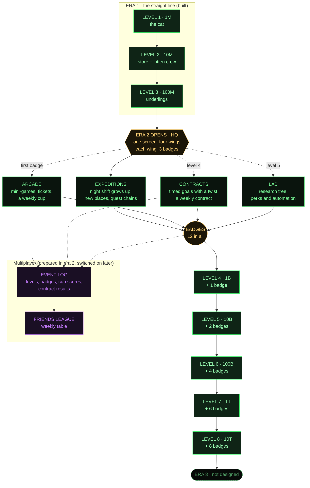

# Era 2: progression map

The plan for what comes after level 3. It builds on [game-map.md](game-map.md) (what
exists), [late-game-ideas.md](late-game-ideas.md) (the ideas) and [progression-research.md](progression-research.md)
(the friends league). The open questions at the end are for the user.

## The idea in one paragraph

Era 1 (levels 1–3) stays a straight line that teaches the systems. At 100M **Era 2** opens: a hub, **HQ**, with
four **wings**: Expeditions, Arcade, Contracts and the Lab. Each wing is a side branch with its own short
progression and three **badges** (bronze, silver, gold). The main line carries on with levels 4–8 (1B → 10T), but
each of those levels also needs a number of badges. The player chooses which wings to chase, so the game
**branches out and joins back** at every level, and the main line is always the spine. Everything competitive
is counted as events, so the friends league can plug in later without redesigning anything.

## The map

## How it stays navigable

1. **One spine.** The goal meter on the main screen always shows the next main level, with two bars: points
   and badges ("LEVEL 5 · 10B · BADGES 1/2"). Whatever else the player does, they can see what's next.
2. **One hub.** All of era 2 lives behind one HQ button (a CRT directory listing, not a map: the city map was
   rejected). Each wing row shows its badges, what's ready (a "!"), and what's next.
3. **Wings open one at a time.** Expeditions at 100M (underlings are already there), the Arcade with the first
   badge, Contracts at level 4, the Lab at level 5. Each gets a one-time intro card, like the crew did.
4. **Every lock says what opens it.** Locked wings, levels and items show their condition, as locked skins do.
5. **Everything feeds the spine.** Each wing gives badges (for levels) and **paw tokens**, era 2's one new
   currency, spent in the Lab. No wing is a dead end. Points stay the main currency, so nothing new competes
   with "the highest number".
6. **Choice without getting lost.** There are 12 badges and level 8 needs 8, so a player can skip a wing they
   don't enjoy and still finish.

## The four wings

| Wing | What the player does | Bronze → silver → gold (example) | Timescale |
| --- | --- | --- | --- |
| **Expeditions** | Night shift (built) grows: new places open per badge (the old silo → the catnip fields → the server room → the roof → the moon), plus **quest chains**: side-quests of 3–5 trips with a story told on the terminal ("the lost blueprint"). | Finish 3 trips · finish a quest chain · finish 3 chains | Hours, overnight |
| **Arcade** | Short mini-games (30–60 s): yarn chase (exists in care time), **conveyor sort**, **laser dot**, **box drop**. Score earns tickets for arcade prizes (skins, spools). A **weekly cup**: one game, same seed for everyone. | Beat a target in each game · a top score · win a weekly cup | Minutes, short sessions |
| **Contracts** | Timed goals with a twist ("earn 1B in 20 min without the cat", "only factory #1 runs"). One **weekly contract** with the same seed for everyone. | Finish 3 contracts · a hard one · 3 golds in one week | 10–60 minutes |
| **Lab** | Spend paw tokens on a research tree: promotion perks (choose 1 of 3), automation (auto-collect, auto-promote, auto-send trips), new mini-games and places. | Research rows 1, 2 and 3 | Spending, choices |

The **album** (skins + stamps) runs alongside all four: stamps are achievements from every wing, so the album
is where the player sees how the concepts connect.

## Preparing for multiplayer now

Decided earlier: a friends-only competition with a small backend, built when the mechanics feel right. Era 2
prepares for it without needing the backend:

- **A profile in the save:** a player name, a random id and a friend code.
- **An event log:** an append-only list in the save (level reached, badge, cup score, contract result, skin
  released). The league later just uploads new events.
- **Shared seeds:** weekly cups and weekly contracts use the week number as their seed, so friends play the same
  thing and scores compare fairly, even before there's a server.
- **Weekly score, defined now:** orders of magnitude gained this week + badges + cup and contract points. This
  rewards play rather than the size of the number, so a new friend can compete with an old one.
- **Test saves are marked.** Using a play-test code (`yumi`, `wakeup`) or a preset flags the save, and flagged
  saves won't count in the league.
- **Later, with the backend:** the league table, gifts (send a friend a spool), co-op contracts.

## Building order (suggested)

1. HQ hub, badges, the badge requirement on levels 4–8, and the goal meter's second bar.
2. Expeditions wing (mostly built): new places and the first quest chain.
3. Arcade with two mini-games (yarn chase exists; add conveyor sort) and tickets.
4. Contracts, with the weekly contract.
5. The Lab and paw tokens.
6. Profile, event log, test flag (small; can go in with step 1).
7. Backend and friends league.

The balance sim needs a model of badges per hour for each wing before levels 4–8 can be tuned.

## Decisions (2026-10-15)

- Levels 4–8 need **points and badges**.
- The four wings: **Expeditions, Arcade, Contracts, Lab**.
- Multiplayer target: the **friends league** first.
- Start with **HQ + badges**.

## Status

- **Built (step 1 + 6):** era 2 opens at level 3 with an "ERA 2" boot screen; HQ (`#screen-hq`, opened from
  "ERA 2 · HQ" under the level bar) shows the next main level with a points bar and a badges bar, the four wings
  (Arcade, Contracts and Lab say COMING SOON), and the profile (name, id, event count, test flag). The level bar
  shows "BADGES n / m". Badges are earned in `step` (`checkBadges`) and toasted. The profile, event log
  (`s.events`, levels, badges, trips) and test flag (codes and presets) are in the save.
- **Expeditions badges** for now: finish 1 / 4 / 10 night shifts (any length). The server room and quest chains
  come with step 2.
- **While wings are missing**, `badgeNeed` shrinks the requirement in proportion to the badges that exist: with
  only Expeditions (3 badges) levels 4–8 need 1 / 1 / 2 / 3 / 3; with all four wings, 1 / 2 / 4 / 6 / 8.
- **Pacing with one wing** (sim, sending up to 3 underlings at a time): levels 4–8 take 33 / 2 / 28 / 60 / 0 min.
  Trip timers set the pace and points race ahead while waiting, so some levels arrive at once. This evens out as
  the Arcade and Contracts add faster badges.
