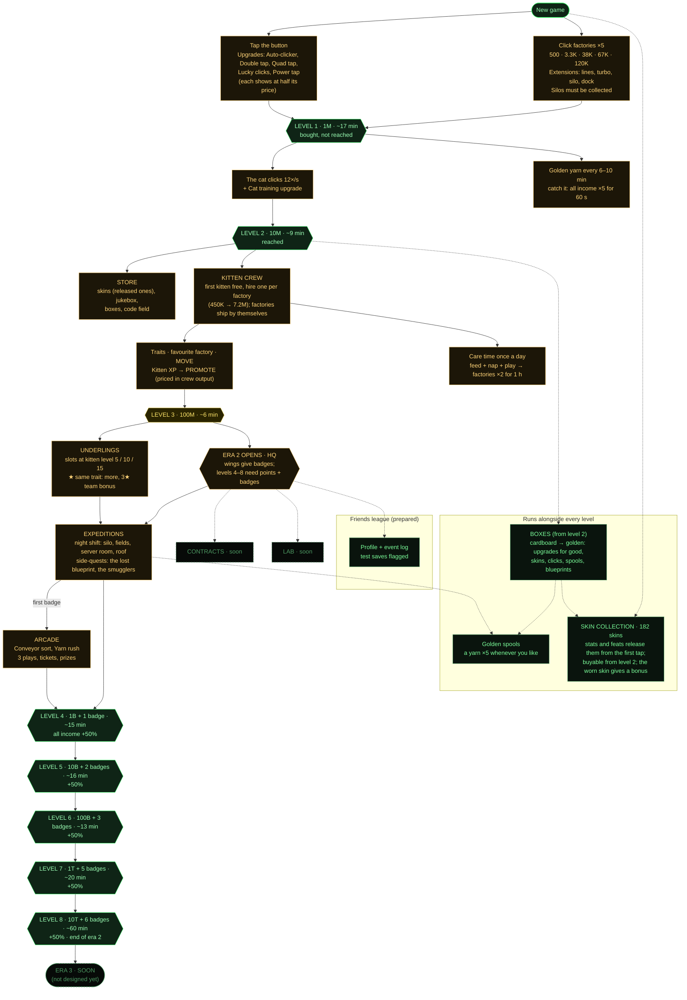

# Game map

The shape of the game: the levels, what each one opens, and the systems that run alongside them. Keep it up
to date when a level, system or unlock changes (the diagram is Mermaid, so GitHub renders it).

Times are minutes of play for the default simulated player (`node scripts/balance-sim.mjs`: 5 taps/s,
collects every 20 s, does care time, catches a golden yarn every 8 min, buys and wears skins, keeps up to 3
underlings on night shifts for badges). Boxes are not in the sim yet. Era 2's full plan is in
[era2-plan.md](era2-plan.md).

## The levels

**Era 1 is one line; era 2 branches.** Levels 1–3 come in the same order for everyone. From level 3 the
wings are side branches that join back at every level through badges: a player picks which wings to chase.
(City branches on a map were tried after level 2 and removed: see CLAUDE.md.)

## The clocks

What brings the player back, on each timescale. Gaps are where the game "just sits there".

| Timescale | What happens | Opens at |
| --- | --- | --- |
| Seconds | Tapping, lucky clicks, Power tap | Start |
| ~1 minute | Collecting silos (until kittens run the factories) | First factory |
| Minutes | Buying upgrades and extensions, promotions, underlings, boxes | Start / L2 / L3 |
| 6–10 minutes | Golden yarn rolls past | L1 |
| 20 min | An arcade play comes back | First badge |
| 30 min – 4 h | Night shift: the old silo, the catnip fields, the roof; side-quest steps | L3 |
| 1 hour | Happy crew from care time runs out | L2 |
| 8 hours | Night shift: the server room; offline progress cap | L3 / start |
| A day | Care time; skin unlocks for care days and streaks | L2 |
| Days to weeks | The rarest skins (9-day care streak, 200 yarns, 100 skins owned) | — |

## Known weak spots

- **Level 3 is short (~6 min)**: care time at 10M doubles the crew for an hour, which carries straight through it.
- **Level 2 (~9 min)** leans almost entirely on the cat.
- **Level 8 waits about an hour** for the last badge (10 night shifts or 30 in Yarn rush): fine as a finale,
  but points pile up meanwhile.
- After level 8 nothing new arrives ("ERA 3 · SOON").
- **Spending competes with levels**: levels check the points you hold, so boxes, skins and promotions all delay
  the next level.
- Night shift and boxes are not in the balance sim, so their effect on level times is unmeasured.
